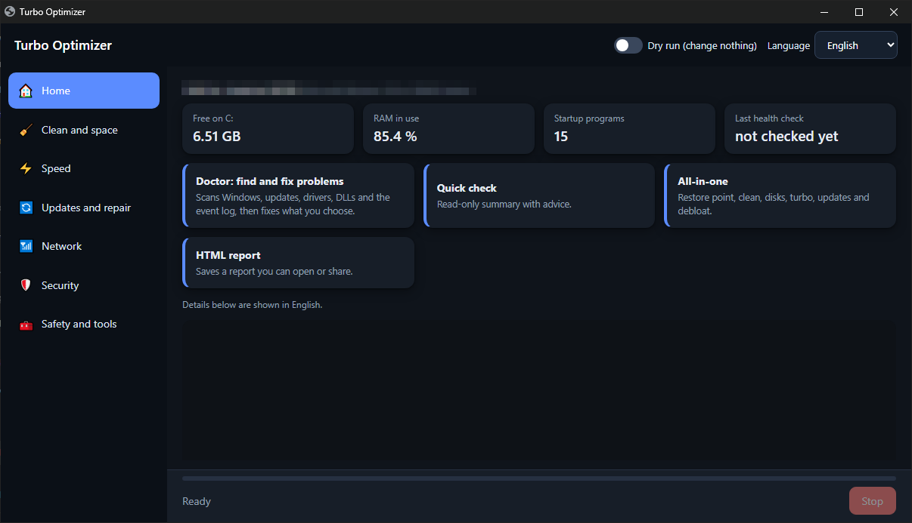
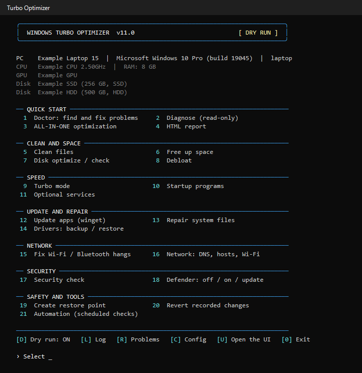
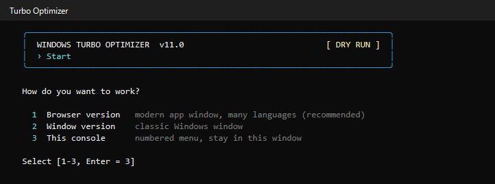

# Turbo Optimizer: free Windows 10/11 optimizer, PC cleaner and repair tool

[](https://github.com/Ebnhussein/TurboOpt/actions/workflows/ci.yml)
[](LICENSE)


**English** | [العربية](docs/README.ar.md) | [Español](docs/README.es.md) | [Français](docs/README.fr.md) | [Deutsch](docs/README.de.md) | [Português](docs/README.pt.md) | [Русский](docs/README.ru.md) | [简体中文](docs/README.zh.md) | [हिन्दी](docs/README.hi.md) | [Türkçe](docs/README.tr.md)

Turbo Optimizer is an open-source **Windows optimizer, system cleaner and repair tool** written in PowerShell. It scans your PC, explains what is wrong, and fixes only what you choose: slow startup, full C: drive, Windows Update errors, missing DLL files, driver problems, Wi-Fi and Bluetooth that keep dropping. Every change is recorded, so you can **undo it**.

No installer, no ads, no telemetry. Run a `.bat` file and pick a console menu, a modern browser window, or a classic Windows window.



| Console menu | Start screen |
|---|---|
|  |  |

The Doctor in Arabic (right-to-left layout, 10 languages in total):


## Features

- **Doctor: find and fix Windows problems.** Scans Windows Update, drivers, missing DLLs and runtimes, disk health, security settings and the event log, then fixes the items you pick.
- **PC cleaner.** Temp files, Windows Update cache, browser caches, a disk space analyzer, TRIM for SSD and defrag for hard drives, and removal of preinstalled apps (debloat).
- **Speed up Windows.** Performance power plan, startup manager (turn off or delay programs), optional services.
- **Update and repair.** App updates through winget, SFC and DISM, driver backup and restore.
- **Network fixes.** Wi-Fi and Bluetooth hang fixes, DNS speed test and switch, hosts file check, Wi-Fi channel check.
- **Security checks.** Firewall, SMBv1, Remote Desktop, UAC, and a reversible Windows Defender off / on / update.
- **Safety first.** Dry-run mode, restore point, an undo journal for every change, a daily health check and weekly maintenance as scheduled tasks.

It asks before closing any program. If you say no, that step is skipped.

## Three ways to run it

| Launcher | What you get |
|---|---|
| `TurboOptimizer.bat` | Console with a numbered menu. On start it offers to open one of the graphical versions. |
| `TurboOptimizerWeb.bat` | Browser version: a local app window (Edge, or Chrome if Edge is missing). 10 languages, right-to-left support. |
| `TurboOptimizerUI.bat` | Classic Windows (WinForms) window. Same languages. |

## Requirements

- Windows 10 version 1809 or newer, or Windows 11
- Windows PowerShell 5.1 (included with Windows)
- Administrator rights (the tool asks for them itself)
- For the browser version: Microsoft Edge or Google Chrome

## Quick start

1. Go to the [latest release](https://github.com/Ebnhussein/TurboOpt/releases/latest) and download **`TurboOptimizer-v….zip`** (under Assets). Do not use "Source code": that is the developer copy.
2. Unzip it and double-click **`Start Turbo Optimizer.bat`**. That is the only file you need to open.
3. Pick the browser version, the window version, or stay in the console.

Developers can clone the repository instead: `git clone https://github.com/Ebnhussein/TurboOpt.git` and run `TurboOptimizer.bat`.

Tick **Dry run** first to see what would happen without changing anything.

## Common problems it helps with

| You search for | Where to look |
|---|---|
| How to clean temp files and free disk space on Windows 10 | Clean files, Free up space |
| Windows PC slow after boot, too many startup programs | Startup programs |
| Bluetooth headphones connected but no sound on Windows | Bluetooth no-sound fix, Bluetooth and audio reset |
| Wi-Fi keeps disconnecting or hangs on Windows 10/11 | Wi-Fi quick reset, Stop power saving, Deep network reset |
| Windows Update stuck, failed or waiting | Doctor, Update and repair |
| Missing DLL error (d3dx9, xinput, MSVCP, VCRUNTIME) | Doctor downloads the runtime from Microsoft |
| Repair corrupted Windows system files (SFC and DISM) | Repair system files |
| Remove bloatware and preinstalled apps from Windows | Remove preinstalled apps |
| Turn Windows Defender off and back on, reversibly | Defender: off / on / update |
| Back up and restore drivers before reinstalling Windows | Back up drivers, Restore drivers |
| Fastest DNS server for my connection | DNS speed test, Switch DNS |
| Check disk errors, NTFS problems, SSD or HDD health | Doctor, Optimize drives |

## Safety

- Dry run mode describes every action and changes nothing.
- A restore point can be created before bigger changes.
- Changes are written to `turbo_undo.json`; the Revert option reverses them.
- Defender can be turned off and back on. Windows Tamper Protection may block this; the tool tells you when it does.
- The browser version listens on `127.0.0.1` only, on a random port, behind a secret token, and the page can only request actions by name.

Read `config.ini` to see which cleanups and apps are on by default, and change them to suit you. Use this tool on your own machine and review what it offers before accepting. See [SECURITY.md](SECURITY.md) to report a vulnerability.

## Languages

English, Arabic, Spanish, French, German, Portuguese, Russian, Chinese (Simplified), Hindi and Turkish. To add one, copy a block in `TurboUI_strings.json`, translate the values and set `_name` and `_rtl`. The console and the detailed scan results are in English.

## FAQ

**Is it safe?** It changes nothing in Dry run mode, asks before risky steps, creates restore points on request, and records every change in an undo journal. You can read the whole source: it is plain PowerShell.

**Does it speed up my PC?** It removes junk, trims startup, and fixes configuration problems. How much that helps depends on your machine. It does not overclock or tweak hidden settings.

**Does it send data anywhere?** No telemetry. It only goes online when you ask it to: winget updates, Windows Update, downloading a missing runtime from Microsoft, DNS tests.

**Does it work on Windows 7, 8 or Linux?** No. Windows 10 (1809+) and Windows 11 only.

**Can I run it without a graphical window?** Yes. `TurboOptimizer.bat` stays in the console and also supports unattended mode for scheduled tasks.

## Files

| File | Purpose |
|---|---|
| `TurboOptimizer.ps1` | The engine and the console menu |
| `TurboOptimizerWeb.ps1`, `TurboWeb.html` | Browser version (local server and page) |
| `TurboOptimizerUI.ps1` | Windows window version |
| `TurboUI_strings.json` | Translations |
| `config.ini` | Lists and options |

Files created at run time (`turbo_log.txt`, `turbo_errors.log`, `turbo_undo.json`, `turbo_acks.json`, health reports) are listed in `.gitignore`.

## Self-test

```powershell
powershell -ExecutionPolicy Bypass -File .\TurboOptimizer.ps1 -SelfTest
powershell -ExecutionPolicy Bypass -File .\TurboOptimizerWeb.ps1 -Test -TestAll
```

Both run in dry-run mode.

## Contributing

Translations: edit only `TurboUI_strings.json` and open a pull request. If the automatic check passes, it is merged without waiting for anyone. Code changes are checked by CI and reviewed by the owner, because this tool runs as administrator. Details in [CONTRIBUTING.md](CONTRIBUTING.md).

If this tool helped you, a star on the repository helps others find it.

## Author

Made by [Ebnhussein](https://github.com/Ebnhussein). Project page: https://github.com/Ebnhussein/TurboOpt

## License

MIT, see `LICENSE`.
