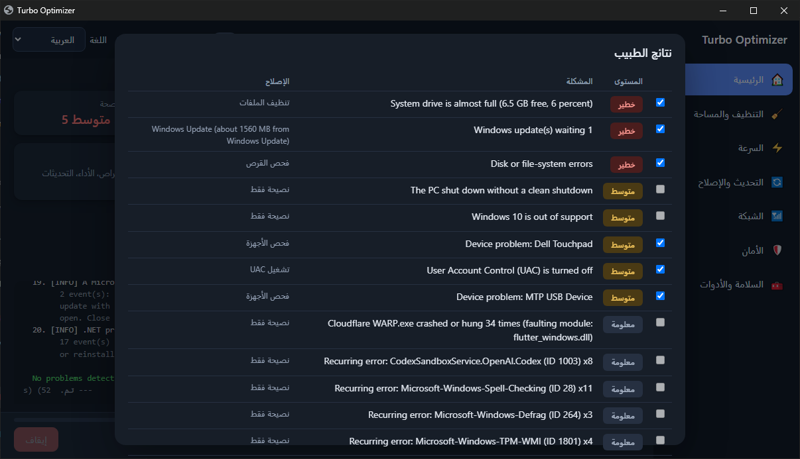

# Turbo Optimizer: أداة مجانية لتسريع وتنظيف وإصلاح ويندوز 10 و11

[English](../README.md) | **العربية** | [Español](README.es.md) | [Français](README.fr.md) | [Deutsch](README.de.md) | [Português](README.pt.md) | [Русский](README.ru.md) | [简体中文](README.zh.md) | [हिन्दी](README.hi.md) | [Türkçe](README.tr.md)

أداة مفتوحة المصدر مكتوبة بـ PowerShell لتنظيف وتحسين وإصلاح ويندوز. بتفحص الجهاز وتشرح المشاكل وتصلّح اللي تختاره بس: بطء التشغيل، امتلاء قرص C، أخطاء تحديث ويندوز، ملفات DLL ناقصة، مشاكل التعريفات، وانقطاع الواي فاي والبلوتوث. كل تغيير بيتسجل وتقدر **ترجع فيه**.

من غير تثبيت ولا إعلانات ولا تتبع. الصق سطر واحد في PowerShell: بينزّل الأداة ويفتحها في نافذة عصرية على المتصفح، ويسألك عايز إيه.



## المميزات

- **الطبيب:** يفحص التحديثات والتعريفات وملفات DLL وصحة الأقراص والأمان وسجل الأحداث، ويصلّح اللي تختاره.
- **تنظيف الجهاز:** الملفات المؤقتة، وكاش التحديثات والمتصفحات، وتحليل المساحة، وTRIM للـSSD، وإزالة التطبيقات المثبتة مسبقاً.
- **تسريع ويندوز:** خطة طاقة للأداء، وإدارة برامج بدء التشغيل، والخدمات الاختيارية.
- **التحديث والإصلاح:** تحديث البرامج بـ winget، وSFC وDISM، ونسخ احتياطي للتعريفات واسترجاعها.
- **إصلاح الشبكة:** تعليق الواي فاي والبلوتوث، واختبار DNS، وفحص ملف hosts وقناة الواي فاي.
- **الأمان:** الجدار الناري وSMBv1 وسطح المكتب البعيد وUAC، وإيقاف وتشغيل Windows Defender بشكل قابل للتراجع.
- **الأمان أولاً:** وضع تجربة، ونقطة استعادة، وسجل تراجع لكل تغيير.

## مشاكل شائعة بيحلها

- **البلوتوث متوصل بس مفيش صوت** على ويندوز 10: إصلاح "بلوتوث بدون صوت".
- **الواي فاي بيفصل أو بيعلّق:** إعادة ضبط الواي فاي وإيقاف توفير الطاقة.
- **قرص C ممتلئ والجهاز بطيء:** تنظيف الملفات، وتحرير المساحة، وبرامج بدء التشغيل.
- **تحديث ويندوز واقف أو فاشل**، أو **ملف DLL ناقص** (مثل d3dx9): الطبيب يصلّحها.
- **إزالة البرامج الجاهزة (Bloatware)** وإيقاف Windows Defender وتشغيله بشكل قابل للتراجع.

## البداية السريعة

```powershell
irm https://ebnhussein.github.io/TurboOpt/i.txt | iex
```

افتح PowerShell والصق السطر ده. هينزّل الأداة ويفتحها في المتصفح ويسألك عايز إيه (والعناية التلقائية: تنظيف أسبوعي أو مراقبة يومية).
